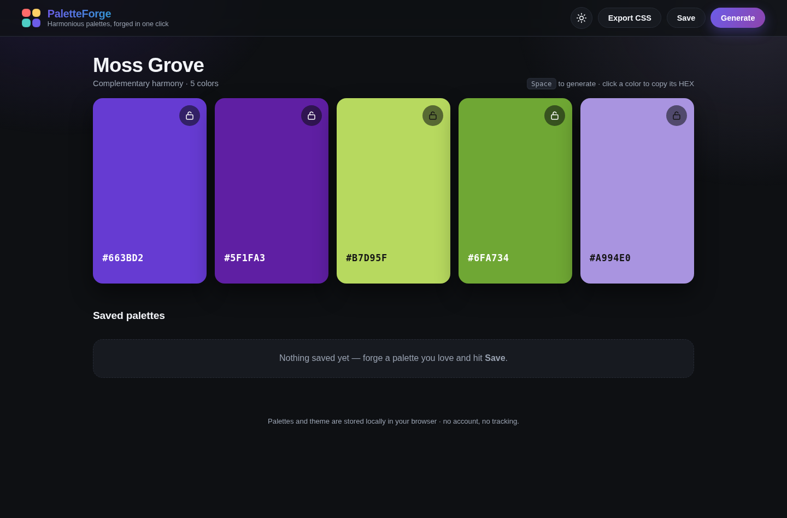

# PaletteForge

A modern, responsive color palette generator. Forge harmonious 5-color palettes in one click — lock the colors you love, copy HEX codes instantly, save favorites locally, and export production-ready CSS variables.



**Live demo:** https://lexiol351.github.io/paletteforge/

## Features

- **Harmonious palette generation** — 5 colors per palette, built from real color-harmony rules (analogous, complementary, triadic, split-complementary, monochromatic, pastel), each with a generated name like *“Velvet Dusk”*
- **Color locking** — lock individual colors and regenerate the rest around them
- **One-click HEX copy** — click any color card to copy its HEX code, with clipboard fallback for non-secure contexts
- **Light / dark themes** — toggle with a persisted preference (dark by default)
- **Saved favorites** — bookmark palettes in `localStorage`, reload or delete them anytime
- **CSS export** — copy the palette as `:root` custom properties (`--palette-1 … --palette-5`)
- **Keyboard-first** — press `Space` to generate a new palette
- **Responsive** — 5-column strip on desktop, adaptive grid on tablet, stacked cards on mobile
- **Polished UI** — staggered card animations, ambient background glow tinted by the palette, toast notifications, `prefers-reduced-motion` support

## Tech stack

- [Vite](https://vite.dev/) + TypeScript (strict)
- Vanilla CSS (custom properties for theming, no frameworks)
- [Vitest](https://vitest.dev/) for unit tests
- GitHub Actions for CI/CD, GitHub Pages for hosting
- No backend, database, or API keys

## Getting started

### Prerequisites

- Node.js 20+ and npm

### Installation

```bash
git clone https://github.com/lexiol351/paletteforge.git
cd paletteforge
npm install
```

### Development

```bash
npm run dev        # start the dev server (http://localhost:5173)
```

### Production build

```bash
npm run build      # typechecks, then emits the production bundle to dist/
npm run preview    # serve the production build locally
```

## Testing

```bash
npm test           # run the Vitest suite once
npm run typecheck  # strict TypeScript check (tsc --noEmit)
```

The suite (45 tests) covers:

| Area | What's tested |
|---|---|
| Palette generation | 5 valid HEX colors, deterministic output for a seeded PRNG, name/harmony labels |
| Color locking | locked colors survive regeneration, unlocked slots refresh, input immutability |
| HEX validation | accepted/rejected formats, shorthand expansion, invalid-input errors |
| Color math | HSL→HEX conversion (primaries, grayscale, hue wrapping), contrast text selection |
| CSS export | exact `:root` block format, custom prefixes, empty palette |
| Persistence | favorites round-trip, corrupt JSON recovery, theme default & round-trip, id uniqueness |

## Project structure

```
paletteforge/
├── index.html
├── src/
│   ├── main.ts          # bootstrap
│   ├── app.ts           # UI controller (rendering, events, clipboard, toast)
│   ├── palette.ts       # color utils + harmonious generation (seedable)
│   ├── cssExport.ts     # CSS custom-properties builder
│   ├── storage.ts       # localStorage persistence (favorites, theme)
│   ├── style.css        # vanilla CSS, light/dark themes, responsive
│   └── *.test.ts        # Vitest suites
├── .github/workflows/
│   ├── ci.yml           # typecheck → test → build on push/PR to main
│   └── deploy.yml       # deploys to GitHub Pages after green CI on main
└── docs/screenshot.png  # app screenshot
```

## CI/CD

- **CI** (`.github/workflows/ci.yml`) runs on every push to `main` and every pull request targeting `main`: `npm ci` → `npm run typecheck` → `npm test` → `npm run build`. Any failure fails the workflow.
- **CD** (`.github/workflows/deploy.yml`) triggers when the CI workflow completes successfully on `main` and deploys `dist/` to GitHub Pages via the official `actions/configure-pages`, `actions/upload-pages-artifact`, and `actions/deploy-pages` actions. Broken builds are never deployed.

## Deployment

The site is published at **https://lexiol351.github.io/paletteforge/** using GitHub Pages with the **GitHub Actions** deployment source. Vite's `base` is set to `/paletteforge/` so assets resolve under the subpath.

## License

MIT — see [LICENSE](LICENSE).
